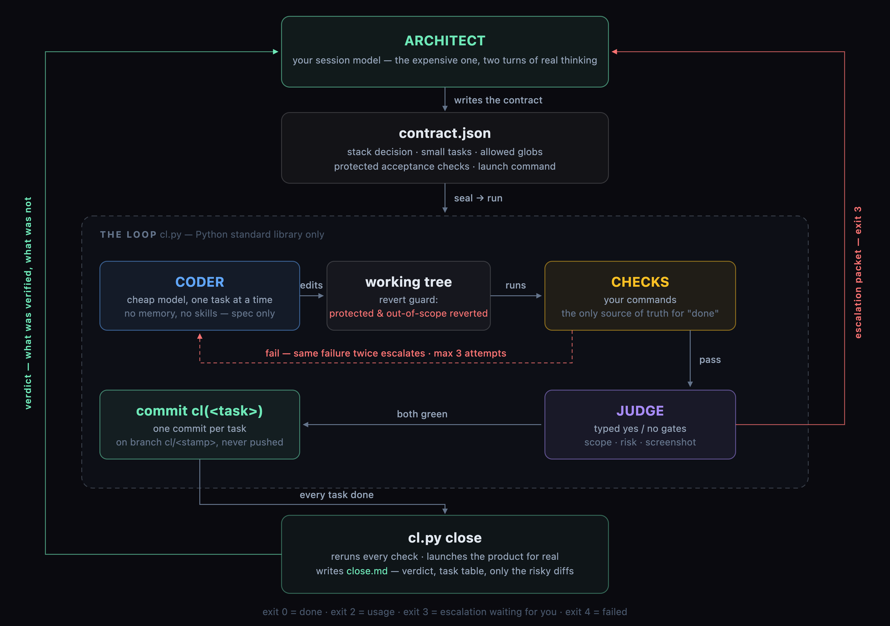

<div align="center">

# hermes-contract-loop

**Build software with a strong model's judgment at a cheap model's price.**

The expensive model writes the **contract** — the stack decision, small tasks, the files each task may touch, and the acceptance checks that prove it done. Then a script runs the loop without it.

[](https://github.com/msebastianb/hermes-contract-loop/actions/workflows/tests.yml)
[](#requirements)
[](#requirements)
[](LICENSE)
[](skills/hermes-contract-loop/SKILL.md)

</div>

---



---

## The idea

Asking a cheap model to "build the feature" fails in a predictable way: it wanders outside the files it should touch, it declares victory without proof, and you spend more tokens reading its output than you saved. Asking the strong model to do everything works, but costs a fortune.

The contract loop splits the work by what each side is actually good at.

| Role | Default model | Job |
|---|---|---|
| **Architect** | your session model | Writes the contract and the acceptance checks. Settles escalations. Gives the final verdict. |
| **Scout** | `deepseek/deepseek-v4.1-flash` | Reads the repo and writes `brief.md` — one page, no more. |
| **Coder** | `deepseek/deepseek-v4.1-flash` | Implements one task at a time. Sees only its spec. |
| **Judge** | `typesafe/jev-1.14` | Typed yes/no gates: scope, repeated failure, screenshot, risk per file. |
| **Mockups** | `qwen/qwen-image-2.1-turbo` | Optional visual target for UI tasks. |
| **Checks** | *your commands* | The only source of truth for "done". |

The architect's tokens go where they're worth the most: **the acceptance checks**. Those are the contract. Everything else is mechanical.

## How a run goes

1. **`init`** — refuses a dirty tree, cuts branch `cl/<stamp>`, creates the state directory *outside* the repo.
2. **`scout`** — the cheap model writes a one-page brief of the repo.
3. **Contract** — you write `contract.json`: stack decision (with a reason), tasks a mid-level dev finishes in under an hour, `allowed` globs per task, `protected` acceptance checks, and the real `launch` command.
4. **`seal`** — validates the contract and commits the checks. They must **fail now** and pass only when the task is genuinely done.
5. **`run`** — the coder implements each task in order. After every attempt: out-of-scope and protected files are reverted, the checks run, the judge gates what checks cannot see. Green means a `cl(<task>)` commit.
6. **`close`** — reruns every check, actually launches the product, writes `close.md` with the verdict, the task table, and only the diffs judged risky or unjudged.
7. **Hand over** — the work sits on `cl/<stamp>`. Nothing is merged or pushed unless you ask.

## Install

```sh
./install.sh                 # → ${HERMES_HOME:-~/.hermes}/skills/software-development/hermes-contract-loop
./install.sh --dir <path>    # custom skills root
```

Then, in Hermes: *"use hermes-contract-loop to build X"*. The procedure lives in [`skills/hermes-contract-loop/SKILL.md`](skills/hermes-contract-loop/SKILL.md).

`install.sh` copies **repo → installed**, so edit the repo and reinstall — never the installed copy alone.

## Commands

Define a shell **function**, not a variable — zsh does not word-split an unquoted variable:

```sh
cl() { python3 "$HOME/.hermes/skills/software-development/hermes-contract-loop/scripts/cl.py" "$@"; }
```

| Command | Does |
|---|---|
| `cl init [--force]` | Clean-tree check, branch `cl/<stamp>`, state dir outside the repo |
| `cl scout --goal "..."` | Cheap model writes `brief.md` (≤ 60 lines) |
| `cl seal` | Validates `contract.json`, commits the acceptance checks |
| `cl run [--no-judge]` | Implements tasks in order — **exit 3** = escalation packet waiting |
| `cl resolve <task>` | Accepts your own fix for an escalated task |
| `cl run --retry <task>` | Discards the failed attempt and starts the task again |
| `cl mockup <task>` | Reference image for a task with a `ui` block |
| `cl close` | Reruns all checks, launches the product, writes `close.md` — **exit 4** = failed |
| `cl status` | One line per task, plus spend so far |

### Exit codes

| Code | Meaning |
|---|---|
| `0` | Done |
| `2` | Usage error |
| `3` | Escalation packet waiting for the architect |
| `4` | Failed |

## What keeps it honest

- **The coder cannot edit the checks.** Files under `protected` (and anything outside `allowed`) are reverted after every attempt.
- **Repeated failure stops early** — the same failure twice escalates instead of burning attempts, and there is a hard cap of 3 attempts per task.
- **The judge is typed, not chatty.** `jev` returns probabilities and choices for scope, risk and screenshots; ambiguous results are flagged `doubt` / `unjudged` for *you* to settle, never silently accepted.
- **`already-green` is a red flag.** If a task was green before the coder touched it, your check was vacuous — fix the check.
- **No launch, no close.** A stub product cannot pass: the real start command must come up.
- **The architect is only shown risky diffs** — the report stays short by design, and flags what it did not read.

## Configuration

Models, thresholds and limits live in `roles.json`, overridable per machine:

```
~/.config/contract-loop/roles.json      # override: CONTRACT_LOOP_ROLES
```

```json
{
  "coder": { "model": "deepseek/deepseek-v4.1-flash", "provider": "openrouter",
             "max_turns": 60, "budget_s": 900, "toolsets": "terminal,file" },
  "judge": { "model": "typesafe/jev-1.14", "accept": 0.8, "reject": 0.2 },
  "limits": { "attempts": 3, "check_timeout_s": 600, "packet_lines": 200,
              "close_diff_chars": 30000 },
  "key_file": null
}
```

### Environment

| Variable | Purpose |
|---|---|
| `CONTRACT_LOOP_ROLES` | Path to the roles override |
| `CONTRACT_LOOP_STATE` | Root for run state (default `$XDG_STATE_HOME/contract-loop`) |
| `CONTRACT_LOOP_HERMES` | Command used to invoke the coder agent (default `hermes`) |
| `CONTRACT_LOOP_API_BASE` | API base for the judge (default `https://openrouter.ai`) |
| `OPENROUTER_API_KEY` | Key for the judge and mockups |

The judge and mockups call OpenRouter directly. Without a key the loop still runs — the gates are skipped and every task is flagged `unjudged` for the architect to read. Or opt in to a key file:

```json
{ "key_file": "~/.config/openrouter/key" }
```

**The key is yours:** the loop never sets `key_file` or reads a secrets file on its own.

### State layout

Everything lives outside the repo, so a failed run never pollutes your worktree:

```
$XDG_STATE_HOME/contract-loop/<repo>-<stamp>/
├── state.json              # task states, spend, failure fingerprints
├── contract.json           # your contract (the example is copied here on init)
├── brief.md                # the scout's one-pager
├── escalations/<task>.md   # packet: spec, last failure, last diff
├── shots/<task>.png        # screenshot for the visual gate
├── mockups/<task>.<ext>    # generated reference images
├── *.out                   # raw agent and API logs
└── close.md                # the final report
```

## Requirements

`hermes` on PATH (the coder runs as `hermes chat --oneshot`) and Python 3.9+.

**Nothing else** — `cl.py` is ~900 lines of standard library. No dependencies, no virtualenv, no lockfile. Both the judge call and the mockup call go over plain `urllib`.

## Test

```sh
python3 -m unittest discover -s tests
```

**14 tests, fully offline.** A fake coder agent and a fake OpenRouter server stand in for the models, so the suite exercises the real loop end to end — happy path, revert guard, escalation-then-resolve, scope gate, key-file opt-in, contract validation, and a `close` that correctly fails when the product will not start. CI runs it on Python 3.9 and 3.13.

## Design notes

- **Contract-first, not prompt-first.** The checks are written *before* any implementation exists, by the model that is best at judging. That is what makes a cheap coder safe to use.
- **The state directory is outside the repo, and `init` refuses a dirty tree** — an acceptance check written beforehand would itself count as dirt.
- **Globs use `fnmatch`**, where `*` also crosses `/` — so `src/*` covers the whole tree under `src`.
- **The short name is load-bearing.** The skill is `hermes-contract-loop`, but its runtime artefacts keep the short name (`~/.config/contract-loop/`, `CONTRACT_LOOP_*`, `cl.py`). Renaming them would lose existing runs and the key override.
- **Private code:** source is sent to the coder model's provider. For private repos, point `coder` at a local model.

## License

[MIT](LICENSE)

<div align="center"><sub>Extracted from real use — the pitfalls in the skill are the ones that actually bit.</sub></div>
